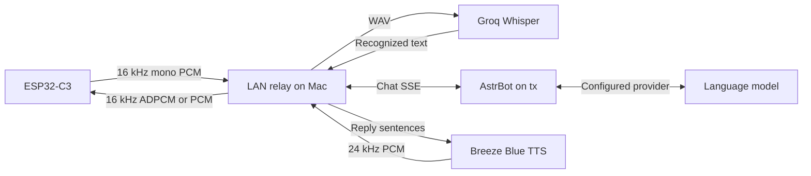

  <a href="astrbot-voice.zh_CN.md">简体中文</a> · <strong>English</strong>

# AstrBot Voice for FoloToy AI Passport

A push-to-talk voice terminal for the FoloToy AI Passport (ESP32-C3, 8 MB Flash,
no PSRAM). Hold OK and speak; the device streams 16 kHz PCM to an
[astrbot-relay](#relay-protocol) server, which runs speech recognition, talks to
AstrBot, and streams the spoken reply back. This branch replaces the baseline
hardware-test menu with its own UI; the BSP in `components/bsp` is unchanged.

Board facts, build rules, and AI workflow remain in [AGENTS.md](../../AGENTS.md) and
[docs/README.md](../README.md).

## Controls

| Where | Key | Action |
| --- | --- | --- |
| Main screen, online | Hold OK | Record; release to send (taps shorter than 350 ms are discarded) |
| Main screen, thinking or speaking | Press OK | Interrupt the reply; keep holding to ask the next question |
| Main screen | Long-press UP | Open Settings (any time except while recording) |
| Main screen, not connected to the relay | Long-press OK | Open Settings |
| Main screen, waiting to retry | Click OK | Reconnect now |
| Settings | UP / DOWN, OK, long-press OK | Move, select, back |

Holding OK is the talk gesture, so a long press of OK cannot also open Settings
while the device is online; long-press UP is the always-available entry.

## Screens

- **Main**: connection status (top left), battery (top right, hidden when the
  fuel gauge is unavailable), a 192 × 192 transparent character that changes
  expression for idle, listening, thinking and speaking, a colored state hint,
  a single line of recognized text, a reply line that scrolls horizontally,
  and a red banner for errors.
- **Settings**: relay address (IPv4 and port editor), Bluetooth provisioning,
  volume (30 to 100 %), clear Wi-Fi, device information.

## Setup

1. Run astrbot-relay on a LAN host the device can reach (default port 8765,
   path `/ws`).
2. Build with `./tools/build_firmware.sh astrbot_voice`, then flash
   `build/astrbot_voice/FoloToy-AI-Passport-full.bin` at `0x0` (see
   [build and test](engineering/build-and-test.md); a merged image can reset NVS).
3. On first boot the device reports that Wi-Fi is not provisioned. Long-press
   OK, choose Bluetooth provisioning, and follow the on-screen steps with the
   companion mini program named in the
   [Wi-Fi provisioning guide](engineering/wifi-provisioning.md#mini-program-name).
   The device advertises as `BLUFI_FoloPassport`; Wi-Fi credentials are stored
   in NVS by `esp_wifi`.
4. Set the relay address in Settings, or send BLUFI custom data
   `relay=ws://<ip>:8765/ws` during provisioning. Add `?token=<auth_token>` when
   the relay sets `server.auth_token`. The build-time default is
   `CONFIG_AV_RELAY_URL_DEFAULT` (menuconfig: *AstrBot Voice*).

The `device_id` sent to the relay is `passport-<last 3 MAC bytes>`; the relay
uses it as the AstrBot username and keeps one session per device.

## LAN voice chain

The configured LAN profile connects the device to the relay on the Mac at
`${RELAY_HOST}:8765/ws`. Wi-Fi credentials and the authenticated relay URL are
stored in device NVS. The relay runs from the sibling `astr2esp32` project.

| Stage | Configured route and behavior |
| --- | --- |
| Device and relay | LAN WebSocket on port 8765, path `/ws`; token authentication when configured |
| ASR | Groq `whisper-large-v3-turbo`, `language: zh`; the relay packages recorded PCM as WAV, then normalizes the transcription to Simplified Chinese |
| Groq network route | The ASR HTTP client uses `socks5://127.0.0.1:1086`; an SSH dynamic forward through `tx` supplies the HTTPS exit |
| AstrBot network route | The relay requests `http://127.0.0.1:6186/api/v1/chat`; SSH forwards port 6186 to `${RELAY_HOST}:6185` on `tx` |
| Reply processing | AstrBot streams text through SSE; the relay cleans and splits it into sentences, then synthesizes each sentence |
| TTS | Breeze Blue, voice `${BREEZE_VOICE_ID}`, speed 1.0; HTTPS uses the Mac's configured network route |
| Playback | Resample TTS audio to 16 kHz, pace 40 ms blocks, negotiate IMA ADPCM or PCM, decode on the device, then play through the I2S codec and speaker |

The SSH forwards used by this LAN profile can be started together with
`ssh -N -L 127.0.0.1:6186:${RELAY_HOST}:6185 -D 127.0.0.1:1086 tx`.
The Mac relay and SSH connection must be running for this profile to work.
ASR, AstrBot and TTS require their upstream services. Device audio delivery
between the Mac and board uses the LAN.

The local profile and credentials are in `build/relay-lan.yaml` and
`build/relay-lan.env`. Keep provider keys in environment variables, and keep
the device URL token in private configuration. The repository excludes these
runtime files, audio captures, firmware archives and logs. The relay README
describes provider settings, protocol negotiation and startup commands.

## Relay protocol

WebSocket at `ws://<relay>:8765/ws`. Text frames are JSON control messages;
uplink binary frames are 16 kHz, 16-bit, mono PCM. The device requests
`audio_codec: "ima_adpcm"` in `hello`; a supporting relay confirms that codec
in its state messages and sends independent IMA ADPCM blocks on the downlink.
Each block has a six-byte little-endian header (int16 first sample, uint8
step index, reserved zero, uint16 sample count), then high-nibble-first codes.
A 40 ms block contains 640 samples in 326 bytes. Replies from older relays
without codec confirmation use PCM. The device decodes to PCM before playback.

| Direction | Message | Device behavior |
| --- | --- | --- |
| Device to relay | `{"type":"hello","device_id":"..."}` | Sent right after the handshake |
| Device to relay | `listen_start`, PCM frames (40 ms, 1280 bytes), `listen_stop` | Hold OK / release OK |
| Device to relay | `abort` | Short tap, interrupt before opening Settings, reply timeout |
| Relay to device | `state` = `idle` / `listening` / `thinking` / `speaking` | Updates the state hint and its color |
| Relay to device | `asr` `{text}` | Shows the recognized text; empty text shows a retry hint |
| Relay to device | `tts_start`, PCM frames, `tts_end` | Uses a 640 ms ring buffer, with 320 ms startup/recovery buffering |
| Relay to device | `reply` `{text, final}` | Appends each sentence to the reply panel |
| Relay to device | `error` `{msg}` | Shows the banner for 6 s |

The relay paces PCM at playback speed with at most 400 ms of lead. A new
`listen_start` or an `abort` cancels the current turn; the device closes a
playback gate at that moment and reopens it on the next `tts_end`,
`state: idle`, or `state: listening`, so audio from the cancelled turn is never
played. A new connection with the same `device_id` replaces the old one.

## Network errors and reconnection

| Situation | Shown as | Recovery |
| --- | --- | --- |
| No saved Wi-Fi | Not provisioned (persistent) | Provision over Bluetooth |
| Wrong Wi-Fi password, network not found | Persistent message | Automatic retry, 1 to 30 s backoff; reprovision if it persists |
| Wi-Fi drop | Temporary message | Automatic retry, 1 to 30 s backoff |
| DNS failure, TCP refused or timed out, HTTP 401/403/404, bad handshake | Persistent message with the cause | Relay retry, 1, 2, 4, 8, 15, 30 s; click OK to retry now |
| No data for 45 s (the relay pings every 20 s) | Relay timeout | Reconnect with backoff |
| No reply 60 s after release | Reply timeout | Sends `abort`, returns to idle |

## Memory and fonts

- Audio is streamed: the microphone task sends each 40 ms frame immediately and
  the player keeps a 20 KB ring buffer and accumulates 320 ms before playback
  and after an underrun. Short tails drain when `tts_end` arrives. Nothing buffers a whole utterance.
- Bluetooth runs only during provisioning; NimBLE is released afterwards.
- Wi-Fi hot paths are not placed in IRAM, which frees internal RAM; the device
  logs free heap, largest block, and minimum free heap every 30 s.
- Chinese text uses a 16 px Noto Sans SC subset (ASCII and all of GB2312, 7544
  glyphs, about 1 MB of Flash), generated by `tools/gen_av_font.py`. Characters
  outside that set, such as emoji, are shown as U+25A1. The source font is
  [Noto Sans SC](https://github.com/notofonts/noto-cjk) under the SIL Open Font
  License 1.1; see [assets/README.md](../../assets/README.md).

## Code layout

| Path | Contents |
| --- | --- |
| `main/av_session.*` | Conversation and link state machine (pure logic) |
| `main/av_proto.*`, `main/av_ws.*`, `main/av_url.*` | Relay JSON, WebSocket framing and handshake, URL parsing (pure logic) |
| `main/av_text.*`, `main/av_ring.*`, `main/av_ipedit.*`, `main/av_anim.*` | UTF-8 cleanup, playback ring and gate, address editor, animation geometry (pure logic) |
| `main/av_app.*` | Application task: event queue, actions, settings pages |
| `main/av_audio.*`, `main/av_net.*`, `main/av_wifi.*` | Audio workers, WebSocket socket task, Wi-Fi and BLUFI |
| `main/av_ui.*` | LVGL screens |
| `tests/test_av_*` | Host tests, run by `./tools/validate.sh --static` |
