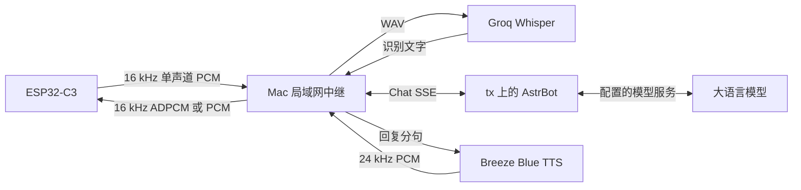

  <strong>简体中文</strong> · <a href="astrbot-voice.md">English</a>

# FoloToy AI Passport 的 AstrBot 语音对讲

运行在 FoloToy AI Passport（ESP32-C3，8 MB Flash，无 PSRAM）上的按键对讲终端。
按住 OK 说话，设备把 16 kHz PCM 流式发给 [astrbot-relay](#中继协议) 中继；中继完成语音识别、
调用 AstrBot，再把合成好的语音流式发回设备播放。本分支用自己的界面替换了基线的硬件测试菜单，
`components/bsp` 里的 BSP 没有改动。

板级事实、构建规则和 AI 工作流仍以 [AGENTS.zh_CN.md](../../AGENTS.zh_CN.md) 和
[docs/README.zh_CN.md](../README.zh_CN.md) 为准。

## 按键

| 场景 | 按键 | 动作 |
| --- | --- | --- |
| 主界面，在线 | 按住 OK | 录音；松开发送（短于 350 ms 的短按不发送） |
| 主界面，思考或说话中 | 按下 OK | 打断回复；继续按住即可直接问下一句 |
| 主界面 | 长按 UP | 进入设置（录音中除外，随时可用） |
| 主界面，未连上中继 | 长按 OK | 进入设置 |
| 主界面，等待重连 | 单击 OK | 立即重连 |
| 设置 | UP / DOWN、OK、长按 OK | 移动、选择、返回 |

在线时按住 OK 就是在说话，所以此时长按 OK 不能同时用来进入设置；长按 UP 是随时可用的入口。

## 界面

- **主界面**：左上角连接状态，右上角电量（电量计不可用时不显示），192 × 192 的透明角色图，
  按待机、聆听、思考、说话切换表情，彩色状态提示，单行识别文字、横向滚动的单行回复，以及红色错误横幅。
- **设置**：中继地址（IPv4 + 端口编辑器）、蓝牙配网、音量（30～100 %）、清除 Wi-Fi、设备信息。

## 使用步骤

1. 在设备能访问的局域网主机上运行 astrbot-relay（默认端口 8765，路径 `/ws`）。
2. 执行 `./tools/build_firmware.sh astrbot_voice`，把
   `build/astrbot_voice/FoloToy-AI-Passport-full.bin` 烧录到 `0x0`
   （见 [构建与测试](engineering/build-and-test.zh_CN.md)；合并镜像可能重置 NVS）。
3. 首次开机会提示未配网。长按 OK，选择「蓝牙配网」，按屏幕提示使用
   [Wi-Fi 配网指南](engineering/wifi-provisioning.zh_CN.md#小程序名称) 中的配套小程序
   「蓝牙配网-FoloToy AI PASSPORT」。设备广播名为 `BLUFI_FoloPassport`；Wi-Fi 凭据由 `esp_wifi` 保存在 NVS。
4. 在设置里填写中继地址，或在配网时通过 BLUFI 自定义数据发送 `relay=ws://<ip>:8765/ws`。
   中继配置了 `server.auth_token` 时加上 `?token=<auth_token>`。编译期默认值为
   `CONFIG_AV_RELAY_URL_DEFAULT`（menuconfig：*AstrBot Voice*）。

发给中继的 `device_id` 是 `passport-<MAC 后 3 字节>`；中继把它作为 AstrBot 用户名，并为每台设备保存一个会话。

## 局域网语音链路

当前局域网配置让设备连接 Mac 上的中继 `${RELAY_HOST}:8765/ws`。
Wi-Fi 凭据和含鉴权信息的中继地址保存在设备 NVS 中，中继代码位于同级的 `astr2esp32` 项目。

| 环节 | 当前配置的路径和行为 |
| --- | --- |
| 设备与中继 | 局域网 WebSocket，端口 8765、路径 `/ws`，配置令牌后进行鉴权 |
| ASR | Groq `whisper-large-v3-turbo`，语言 `zh`；中继把录音 PCM 封装为 WAV，识别结果再转成简体中文 |
| Groq 网络路径 | ASR HTTP 客户端使用 `socks5://127.0.0.1:1086`，经 SSH 动态转发从 `tx` 访问 HTTPS 接口 |
| AstrBot 网络路径 | 中继请求 `http://127.0.0.1:6186/api/v1/chat`，SSH 将 6186 端口转发到 `tx` 的 `${RELAY_HOST}:6185` |
| 回复处理 | AstrBot 通过 SSE 流式返回文字，中继清洗和切分句子，再逐句合成语音 |
| TTS | Breeze Blue，音色 `${BREEZE_VOICE_ID}`，语速 1.0；HTTPS 使用 Mac 配置的网络出口 |
| 播放 | TTS 重采样到 16 kHz，以 40 ms 音频块节流下发，协商使用 IMA ADPCM 或 PCM，设备解码后经 I2S codec 和扬声器播放 |

本局域网配置所用的 SSH 转发可通过
`ssh -N -L 127.0.0.1:6186:${RELAY_HOST}:6185 -D 127.0.0.1:1086 tx` 同时启动。
这套配置依赖 Mac 中继和 SSH 连接持续运行。ASR、AstrBot 和 TTS 需要访问各自的上游服务，
Mac 与开发板之间的音频下发走局域网。

本机运行配置和凭据位于 `build/relay-lan.yaml`、`build/relay-lan.env`。
服务密钥通过环境变量提供，设备 URL 令牌保存在私有配置中。仓库排除这些运行文件、
录音、固件归档和日志。中继项目 README 记录了服务配置、协议协商和启动命令。

## 中继协议

WebSocket 地址 `ws://<中继>:8765/ws`。文本帧是 JSON 控制消息，上行二进制帧是 16 kHz、16 bit、单声道 PCM。
设备在 `hello` 中请求 `audio_codec: "ima_adpcm"`，支持的中继会在状态消息中确认，并以下行独立 IMA ADPCM 块传输音频。
每块含六字节小端头部（int16 首样本、uint8 步长索引、保留零字节、uint16 样本数），随后是高半字节优先的编码数据。
每块 40 ms、640 样本，共 326 字节。旧中继未确认编码时使用 PCM，设备在播放前解码为 PCM。

| 方向 | 消息 | 设备行为 |
| --- | --- | --- |
| 设备 → 中继 | `{"type":"hello","device_id":"..."}` | 握手完成后立即发送 |
| 设备 → 中继 | `listen_start`、PCM 帧（40 ms，1280 字节）、`listen_stop` | 按住 OK / 松开 OK |
| 设备 → 中继 | `abort` | 短按、进设置前打断、等待回复超时 |
| 中继 → 设备 | `state` = `idle` / `listening` / `thinking` / `speaking` | 更新状态提示及其颜色 |
| 中继 → 设备 | `asr` `{text}` | 显示识别文字；为空时提示没听清 |
| 中继 → 设备 | `tts_start`、PCM 帧、`tts_end` | 640 ms 环形缓冲，启动/欠载后先积累 320 ms |
| 中继 → 设备 | `reply` `{text, final}` | 每句追加到回复面板 |
| 中继 → 设备 | `error` `{msg}` | 横幅显示 6 秒 |

中继按播放速度节流下发 PCM，最多领先 400 ms。新的 `listen_start` 或 `abort` 会取消当前一轮；
设备在打断的同时关闭播放闸门，直到收到下一个 `tts_end`、`state: idle` 或 `state: listening` 才重新打开，
因此被取消那一轮的残留音频不会被播放。同一 `device_id` 的新连接会顶掉旧连接。

## 网络错误与重连

| 情况 | 显示 | 恢复 |
| --- | --- | --- |
| 没有保存的 Wi-Fi | 未配网（持续显示） | 蓝牙配网 |
| Wi-Fi 密码错误、找不到网络 | 持续显示的提示 | 自动重试，1～30 秒退避；一直失败就重新配网 |
| Wi-Fi 掉线 | 临时提示 | 自动重试，1～30 秒退避 |
| 域名解析失败、TCP 被拒或超时、HTTP 401/403/404、握手校验失败 | 持续显示具体原因 | 按 1、2、4、8、15、30 秒重连；单击 OK 立即重试 |
| 45 秒没有任何数据（中继每 20 秒 ping 一次） | 中继无响应 | 退避重连 |
| 松开后 60 秒没有回复 | 等待回复超时 | 发送 `abort`，回到待机 |

## 内存与字体

- 音频边录边发：录音任务每 40 ms 一帧立即发送，播放端使用 20 KB 环形缓冲，启动及欠载后先积累 320 ms，`tts_end` 到达后直接排空短尾音，不缓存整段语音。
- 蓝牙只在配网期间运行，配网结束后释放 NimBLE。
- Wi-Fi 收发热路径不放进 IRAM，以腾出内部 RAM；设备每 30 秒打印一次可用堆、最大连续块和历史最低可用堆。
- 中文使用 16 px 的 Noto Sans SC 子集（ASCII + 全部 GB2312，共 7544 个字形，约 1 MB Flash），
  由 `tools/gen_av_font.py` 生成。字符集外的字符（如 emoji）显示为 U+25A1 □。源字体为
  [Noto Sans SC](https://github.com/notofonts/noto-cjk)，SIL Open Font License 1.1，见 [assets/README.zh_CN.md](../../assets/README.zh_CN.md)。

## 代码结构

| 路径 | 内容 |
| --- | --- |
| `main/av_session.*` | 对话与连接状态机（纯逻辑） |
| `main/av_proto.*`、`main/av_ws.*`、`main/av_url.*` | 中继 JSON、WebSocket 帧与握手、地址解析（纯逻辑） |
| `main/av_text.*`、`main/av_ring.*`、`main/av_ipedit.*`、`main/av_anim.*` | UTF-8 清洗、播放缓冲与闸门、地址编辑器、动画几何（纯逻辑） |
| `main/av_app.*` | 应用任务：事件队列、动作执行、设置页 |
| `main/av_audio.*`、`main/av_net.*`、`main/av_wifi.*` | 音频 worker、WebSocket socket 任务、Wi-Fi 与 BLUFI |
| `main/av_ui.*` | LVGL 界面 |
| `tests/test_av_*` | 主机端测试，由 `./tools/validate.sh --static` 运行 |
